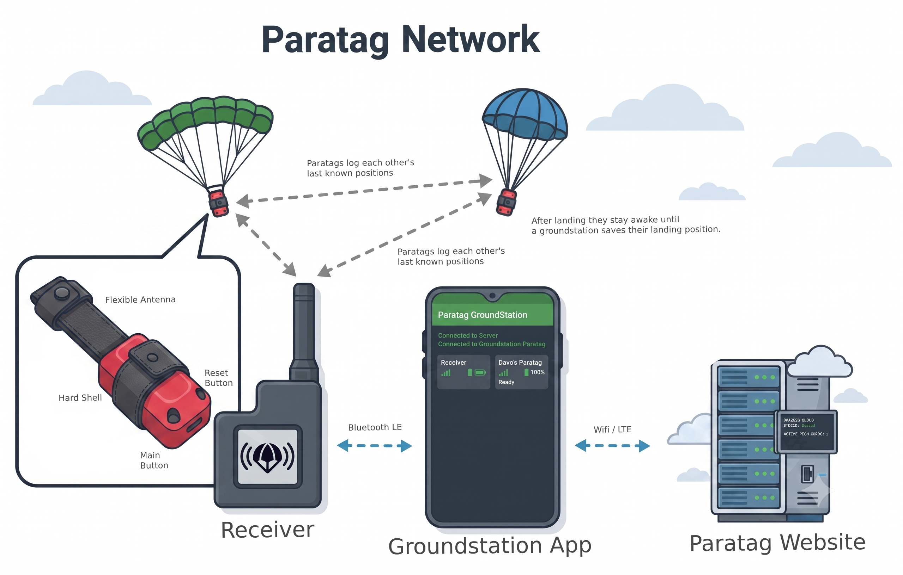
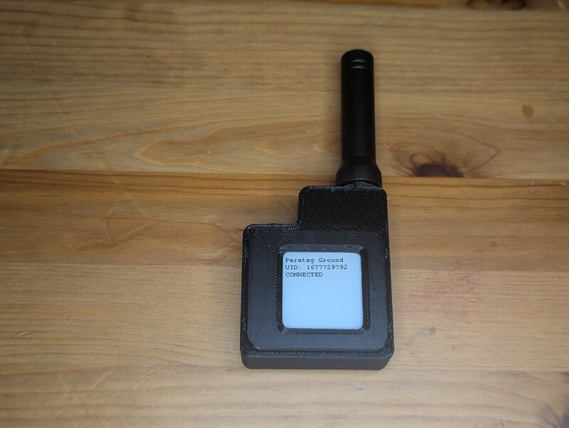
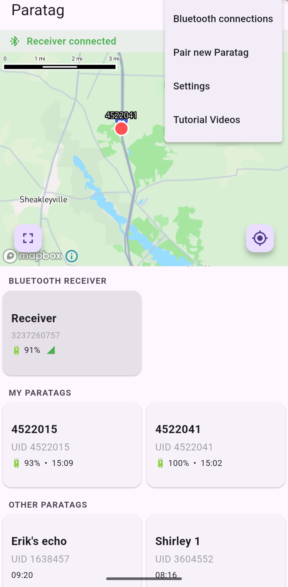
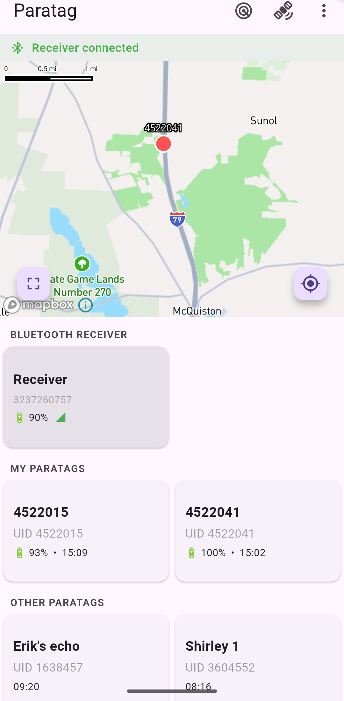
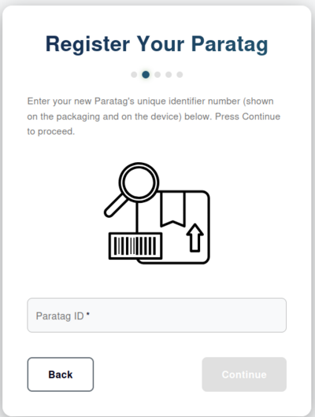
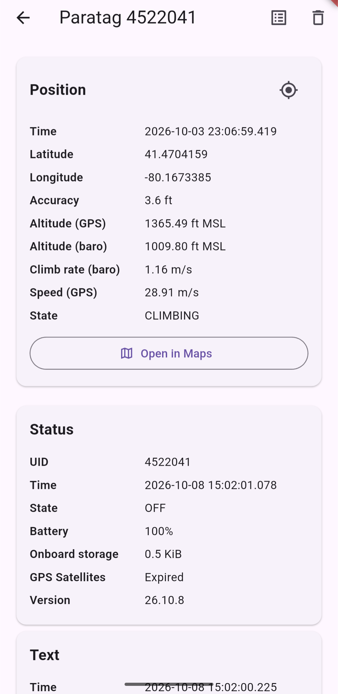
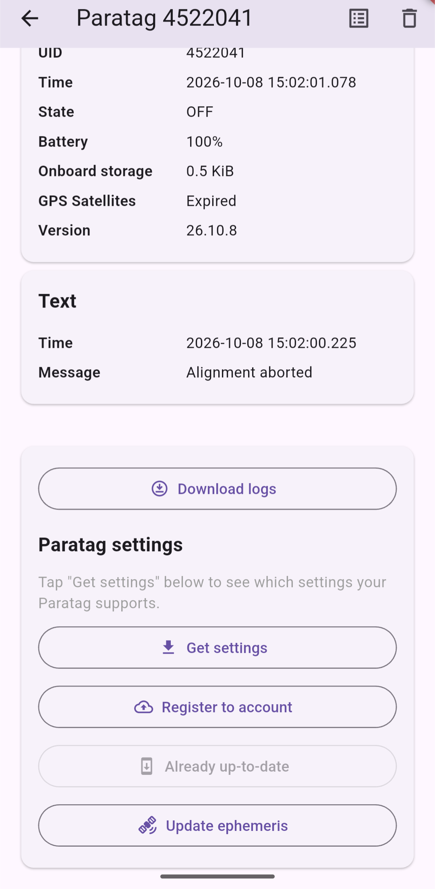
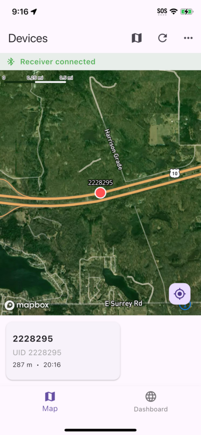
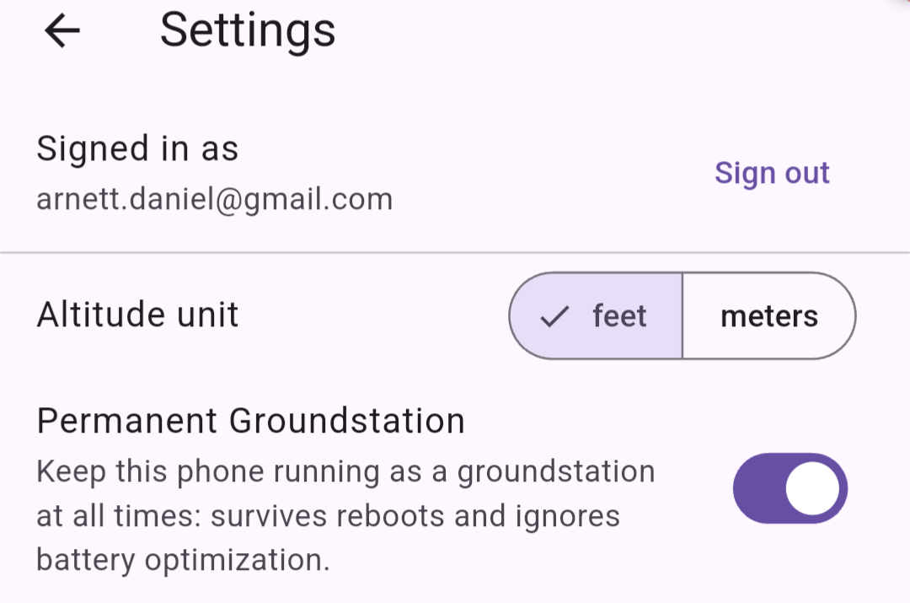

# Paratag User Manual

## Disclaimer

Skydiving is an inherently dangerous activity. Mounting any device to a parachute system introduces additional risk. It is the sole responsibility of the skydiver jumping with Paratag to have their installation approved by a current, certified rigger to assess whether mounting a Paratag is appropriate for their equipment and jump conditions. By using Paratag you accept all risks of injury or death resulting from use or misuse of this device.

---

## Paratag Overview

Paratag is a small GPS transmitter designed to be mounted on a skydiving rig. It transmits its position over radio to a ground receiver, which relays the data to a phone app and cloud server in real time.

  <a href="https://www.youtube.com/playlist?list=PLRnppc4hiiLs" title="Paratag How-To Guide — Watch on YouTube">
     
    ▶&nbsp;Watch the How-To Guide on YouTube
  </a>
   
   
   

### Mounting

<!-- TODO: describe recommended mounting location on the rig, hardware required, TSO/PMA considerations -->

### Using the Buttons

| Press | Meaning |
|---------|---------|
| AAD Tap Sequence | Turn on / Turn off |
| Short tap | Wake Radio  Transmit STATUS message Check GPS Alignment |
| Hold | Pairing mode |
| Double tap | Cancel GPS Alignment |

### LEDs

| Pattern | Meaning | Animation (may need to click) |
|---------|---------|:-------:|
| One short Blink | Paratag turned Off | 

 |
| Long blink with a brief gap | Paratag turned On | 

 |
| **Repeating:** |  | |
| Heartbeat | GPS Aligning | 

 |
| Occasional Blink | Transmitting / Waiting for landing acknowledgement | 

 |
| Half on / half off (blue) | Pairing mode | 

 |

---

## App Status

| Feature | Android | iOS |
|---------|:-------:|:-------:|
|Download Link|[ Google Play](https://play.google.com/store/apps/details?id=com.flyparatag.groundstation)|[ App Store](https://apps.apple.com/gh/app/paratag/id6793327939)|
| Receive live Paratag positions | ✅ | ✅ |
| Change Paratag settings | ✅ | ✅ |
| Receive live Paratag positions | ✅ | ✅ |
| Receive live Paratag positions | ✅ | ✅ |
| Download logs | ✅ | ✅ |
| OTA Firmware Updates | ✅ | ✅ |

### Creating a Paratag Account / Signing In

<!-- TODO -->

### Connecting to the Bluetooth Receiver

The app connects to a receiver over Bluetooth.

Tap the 3 dot icon ⋮ in the top-right of the app and choose "Bluetooth connections"

  

Your Paratag Receiver should appear in this screen if it's on.

  

The top of the map screen should now say "Receiver connected"

  

Your app will now download any Paratag messages stored on the receiver, and can now receive any 

### Pairing a New Paratag via the App

1. Turn on the Paratag (like an AAD).
2. Hold the button until the LED flashes blue (half on / half off) — this is pairing mode.
3. In the app, tap the three-dot icon ⋮ in the top right open **Pair New Paratag** and tap **Send Pairing Request**.
4. Repeat until the app confirms pairing succeeded.

  

### Register a Paired Paratag to Your Account

Visit https://app.flyparatag.com/#/registerdevice to begin registering a paratag to your account. It will ask you about a Paratag ID. This is the unique identifier number assigned to your Paratag, and will appear in your app

  

After pairing, open the device detail screen and tap **REGISTER PARATAG** (Android) or **Register to account** (iOS) to associate the beacon with your online account.

  
   
  

### Seeing All Paratag Devices

The main screen lists your paired beacons, other beacons heard by the receiver, and the receiver itself. Each card shows the last-seen time, battery level, and current state.

  

### Device Details Screen

Tapping a device shows its last known GPS position, altitude, rate of ascent, state, flash memory usage, firmware version, and configurable parameters (power level, auto-shutdown timer).

---

## Permanent Groundstation

If you would like to keep a Receiver set up permanently at your DropZone, [please contact us](https://flyparatag.com/contact/) for a FREE receiver! All you need to buy is a [$30 Android phone](https://www.walmart.com/ip/ST-MOTOROLA-XT2513V-CDMA-LTE-GRAY-HANDSET-64GB-WALMART-POSA/14552506783), or use a spare if you already have one. iPhones might work, but we recommend Android for this because Android apps can be designed to run all the time in the background.

To set up a permanent groundstation, just connect an phone to a Receiver like normal, go to the settings, and enable "Permanent Groundstation". We also recommend that the phone be set to not have a lock PIN, that way the app should immediately restart after a reboot.

  

You can also set up improved antennas for your permanent groundstation like [this magnetic one](https://www.amazon.com/Meshtastic-Magnetic-Extension-Development-Slinkdsco/dp/B0FG6XXSTW). Antennas should be tuned for 915MHz in the North/South America, Australia, and New Zealand. Europe through Africa mostly uses 863MHz.

## Website

https://app.flyparatag.com

### Jump Logs

<!-- TODO: describe how completed jumps appear in the web portal, filtering, export -->

### Live Streaming Jump Data

<!-- TODO: describe real-time tracking view during an active jump -->

